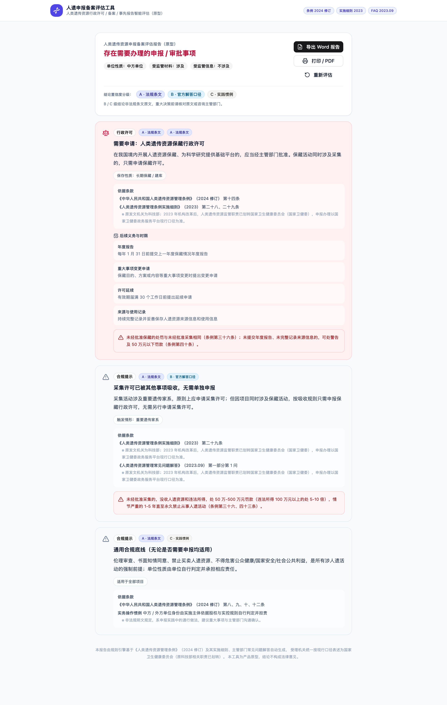

# 人类遗传资源申报备案评估工具（HGR Compliance Tool）

[](https://github.com/zrzbpsrpkw-hash/hgr-compliance-tool/actions/workflows/rules-test.yml)

> 出品 / 维护：**庚寅咨询 · Gengyin Consulting** — 青岛庚寅咨询服务有限公司（CNAS 认可 · ISO 17025/15189/20387 · 人类遗传资源合规咨询）

基于规则引擎的中国人类遗传资源（HGR）行政许可 / 备案 / 事先报告智能评估工具原型。回答 10–15 道分层问题，即可判断项目需要哪条申报路径，并生成带条款引用、置信度分级、后续义务时限与罚则提示的评估报告（可导出 Word）。

> 🆕 **规则库 v2.0.0（2026-11-11）**：已按《人类遗传资源管理条例实施细则》（国家卫生健康委员会令第 16 号）完成全量换版，旧版科技部令第 21 号同时废止、无过渡期。采集门槛 3000→10000 例、保藏定义收窄、年报内容替换、安全审查条款删除、新增论文会议视为报告等。逐条变化见 `docs/换版条号映射-16号令.md`。

> ⚠️ **免责声明**：本工具为产品原型，所有输出均为基于公开法规的自动化初步评估，**不构成法律意见**。重大决策请核对法规原文并咨询主管部门或专业律师。

## 界面预览

| 入口：双用户 + 双流程 | 向导：四层决策漏斗 |
|---|---|
|  |  |

| 评估报告：结论 + 条款引用 + 置信度分级 + 义务时限 + 罚则提示 |
|---|
|  |

## 功能特性

**两条评估流程**

- **新项目申报评估**：四层决策漏斗 —— 身份识别 → 资源识别 → 活动识别 → 触发与豁免判断
- **已获批项目管理**：变更 / 延续 / 报告评估，区分变更审批、备案变更、书面说明三级义务

**规则覆盖**

- 采集行政许可（清单目录内重要遗传家系 / 特定地区 / 大规模人群研究 >10000 例、反拆分、临床试验豁免）
- 保藏行政许可（2026 版定义收窄为"仅用于科学研究"、三类排除情形、8 项申请材料、年度报告 4 项内容、吸收规则）
- 国际合作科学研究行政许可（含 5 项申请材料、IIT；探索性研究自 2026 版起无需单独申报）
- 国际合作临床试验备案（上市目的、不出境、境内检测分析条件、同日确认、6 项备案材料）
- 人遗材料出境审批（7 项申请材料、与国际合作合并审批、豁免材料）
- 人遗信息对外提供 / 开放使用事先报告 + 信息备份（含潜在风险评估报送、变更重报）
- 信息分类管理：论文 / 会议递交国家生物信息中心视为完成报告、三类免单独报告情形
- 变更分级：重大事项变更审批 vs 10% 或 10 例以内等书面说明（实施细则第 33–34 条）
- 备案转许可、许可转备案、合作方变更为外方单位等特殊情形
- 豁免与吸收规则：保藏/国际合作吸收采集、EDC 供应商豁免、外方仅资助豁免、协议内信息共享免报告、尿液/粪便/血清/血浆豁免、已公开数据豁免等
- 单位主体责任：法定代表人负责、建台账、定期自查（第 10 条）

**产品设计**

- 结论**置信度三级标注**：A 法规条文 / B 主管部门解答口径 / C 实践惯例，避免把 FAQ 口径误当法规条文
- 每条结论可溯源至具体条款，受理机关统一表述为国家卫生健康委员会 / 省级人民政府人类遗传资源主管部门（2026 版细则第 4 条）
- 规则覆盖不到的灰色地带（如单位股权结构不明）自动提示**转人工咨询**，不给推测性结论
- 评估报告浏览器端导出 Word（.docx），含回答摘要表，可留痕归档
- 双用户入口：企业合规/注册（完整评估）与研究者/BD（快速判断）

## 技术栈

React 19 + TypeScript + Vite + Tailwind CSS + shadcn/ui + docx（Word 导出）

规则引擎为纯 TypeScript 数据 + 函数（`src/rules/`），与 UI 完全解耦，可独立复用。

## 快速开始

```bash
npm install
npm run dev        # 开发服务器 http://localhost:3000
npm run build      # 生产构建 → dist/
npm run test:rules # 规则引擎冒烟测试（59 条典型路径回归，含换版专项 B1–B9）
npm run screenshots # 重截 README 预览图（首次需 npx playwright install chromium）
```

## 项目结构

```
src/
├── rules/               # 规则引擎（与 UI 解耦，核心资产）
│   ├── types.ts         #   类型：置信度、条款引用、结论、题库
│   ├── questions.ts     #   题库：四层决策漏斗 + 变更评估题组
│   ├── evaluate.ts      #   评估器：答案 → 结论/义务/风险/灰色地带
│   ├── regulations.ts   #   法规版本注册表（v2.0.0 / 2026 换版快照）
│   └── glossary.ts      #   术语官方定义（2026 版条文）
├── components/
│   ├── Wizard.tsx       # 向导式问卷
│   └── ResultView.tsx   # 评估报告页
├── utils/
│   └── exportDocx.ts    # Word 报告导出
└── pages/Home.tsx       # 入口与流程编排
docs/
├── RULES.md                 # 规则库说明（决策漏斗/判定表/变更/口径）
├── 换版条号映射-16号令.md      # 2023 版 → 2026 版逐条映射与实体变化
├── faq-2025-比对报告.md
├── 问题解答之一至之五-比对报告.md
└── screenshots/         # README 界面预览图（npm run screenshots 重新生成）
scripts/
└── screenshots.mjs      # 截图脚本：自动启停 dev server 并重截预览图
smoke-test.mts           # 规则引擎冒烟测试（npm run test:rules）
```

## 规则依据与口径说明

| 依据文件 | 置信度 | 说明 |
|---|---|---|
| 《中华人民共和国人类遗传资源管理条例》（2024 修订） | A | 行政法规 |
| 《人类遗传资源管理条例实施细则》（2026，国家卫健委令第 16 号） | A | 2026-11-11 公布施行，8 章 61 条；科技部 2023 年第 21 号令同时废止、无过渡期 |
| 《人类遗传资源管理常见问题解答》（2025.03）及之一至之五 | B | 主管部门窗口解答口径，非法规条文；2023.09 旧问答与新细则不一致处以新细则为准 |
| 申报实践惯例 | C | 通行做法，重大事项建议与主管部门沟通确认 |

详细逐条映射（含实体规则变化）见 `docs/换版条号映射-16号令.md`。
法规更新时，优先修改 `src/rules/regulations.ts`（版本快照）、`evaluate.ts`（结论与引用）、`questions.ts`（题目与阈值）与 `glossary.ts`（术语），并运行 `npm run test:rules` 回归。

## 贡献

欢迎提交 Issue 与 PR，尤其是：

- 规则库纠错与补充（请附条款依据）
- 真实案例回归（请脱敏）
- 题库措辞与边界情形讨论

## License

[MIT](LICENSE)（代码）。中方/外方单位合规操作指引文档因版权归原作者所有，未包含在本仓库中。
