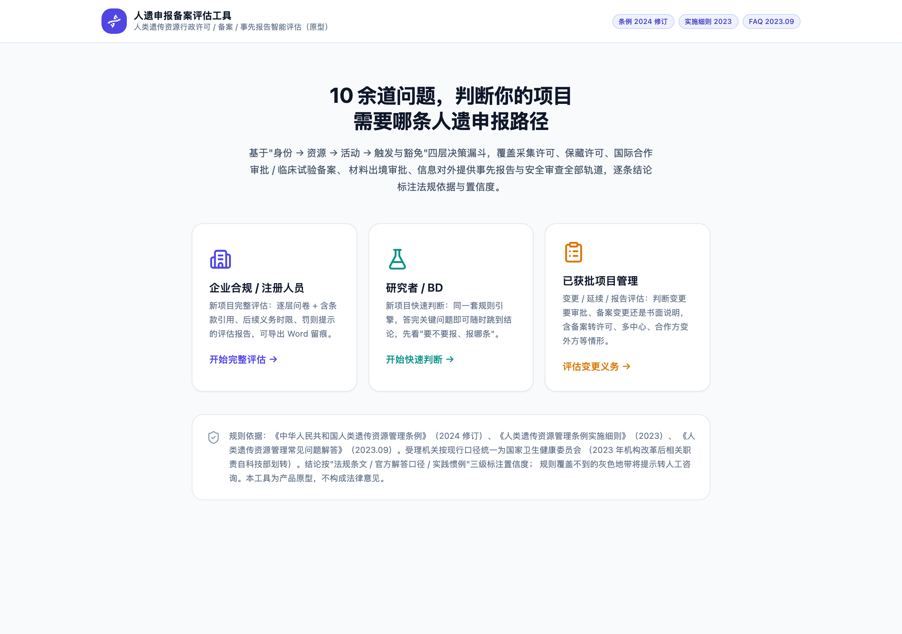
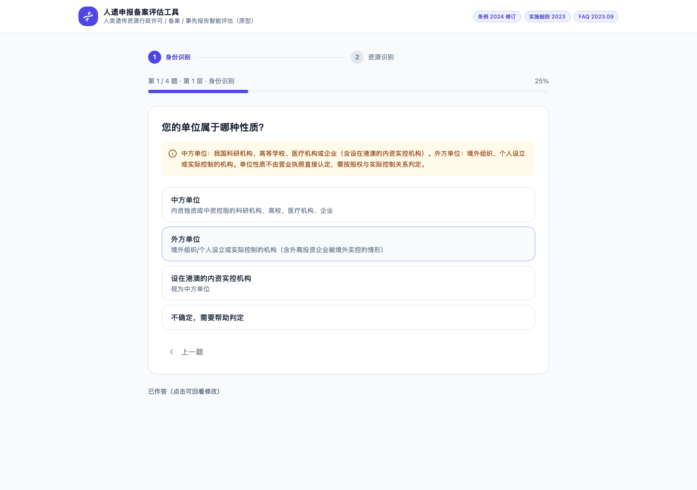

# 人类遗传资源申报备案评估工具（HGR Compliance Tool）

基于规则引擎的中国人类遗传资源（HGR）行政许可 / 备案 / 事先报告智能评估工具原型。回答 10–15 道分层问题，即可判断项目需要哪条申报路径，并生成带条款引用、置信度分级、后续义务时限与罚则提示的评估报告（可导出 Word）。

> ⚠️ **免责声明**：本工具为产品原型，所有输出均为基于公开法规的自动化初步评估，**不构成法律意见**。重大决策请核对法规原文并咨询主管部门或专业律师。

## 界面预览

| 入口：双用户 + 双流程 | 向导：四层决策漏斗 |
|---|---|
|  |  |

| 评估报告：结论 + 条款引用 + 置信度分级 + 义务时限 + 罚则提示 |
|---|
|  |

## 功能特性

**两条评估流程**

- **新项目申报评估**：四层决策漏斗 —— 身份识别 → 资源识别 → 活动识别 → 触发与豁免判断
- **已获批项目管理**：变更 / 延续 / 报告评估，区分变更审批、备案变更、书面说明三级义务

**规则覆盖**

- 采集行政许可（重要遗传家系 / 特定地区 / 大规模人群研究 >3000 例及临床试验豁免）
- 保藏行政许可（临时存储排除、吸收规则、年度报告义务）
- 国际合作科学研究行政许可（含探索性研究部分、IIT）
- 国际合作临床试验备案（上市目的、不出境、境内检测分析条件）
- 人遗材料出境审批（与国际合作合并审批、豁免材料）
- 人遗信息对外提供 / 开放使用事先报告 + 信息备份
- 安全审查（重要遗传家系信息 / 特定地区信息 / >500 例测序信息）
- 变更分级：重大事项变更审批 vs 10% 以内等书面说明（实施细则第 46–47 条）
- 备案转许可、许可转备案、合作方变更为外方单位等特殊情形
- 豁免与吸收规则：保藏吸收采集、国际合作吸收采集、EDC 供应商豁免、外方仅资助豁免、协议内信息共享免报告、尿液/粪便/血清/血浆豁免、已公开数据豁免等

**产品设计**

- 结论**置信度三级标注**：A 法规条文 / B 主管部门解答口径 / C 实践惯例，避免把 FAQ 口径误当法规条文
- 每条结论可溯源至具体条款，受理机关按现行口径统一表述（2023 年机构改革后相关职责自科技部划转国家卫健委）
- 规则覆盖不到的灰色地带（如单位股权结构不明）自动提示**转人工咨询**，不给推测性结论
- 评估报告浏览器端导出 Word（.docx），含回答摘要表，可留痕归档
- 双用户入口：企业合规/注册（完整评估）与研究者/BD（快速判断）

## 技术栈

React 19 + TypeScript + Vite + Tailwind CSS + shadcn/ui + docx（Word 导出）

规则引擎为纯 TypeScript 数据 + 函数（`src/rules/`），与 UI 完全解耦，可独立复用。

## 快速开始

```bash
npm install
npm run dev        # 开发服务器 http://localhost:3000
npm run build      # 生产构建 → dist/
npm run test:rules # 规则引擎冒烟测试（19 条典型路径回归）
```

## 项目结构

```
src/
├── rules/               # 规则引擎（与 UI 解耦，核心资产）
│   ├── types.ts         #   类型：置信度、条款引用、结论、题库
│   ├── questions.ts     #   题库：四层决策漏斗 + 变更评估题组
│   └── evaluate.ts      #   评估器：答案 → 结论/义务/风险/灰色地带
├── components/
│   ├── Wizard.tsx       # 向导式问卷
│   └── ResultView.tsx   # 评估报告页
├── utils/
│   └── exportDocx.ts    # Word 报告导出
└── pages/Home.tsx       # 入口与流程编排
docs/
└── background/          # 背景文档：中方/外方单位合规操作流程指引
smoke-test.mts           # 规则引擎冒烟测试（npm run test:rules）
```

## 规则依据与口径说明

| 依据文件 | 置信度 | 说明 |
|---|---|---|
| 《中华人民共和国人类遗传资源管理条例》（2024 修订） | A | 行政法规 |
| 《人类遗传资源管理条例实施细则》（2023） | A | 部门规章；原发文机关为科技部，2023 年机构改革后监管职责已划转国家卫生健康委员会 |
| 《人类遗传资源管理常见问题解答》（2023.09） | B | 主管部门窗口解答口径，非法规条文 |
| 申报实践惯例 | C | 通行做法，重大事项建议与主管部门沟通确认 |

法规更新时，优先修改 `src/rules/evaluate.ts` 中的结论与引用、`src/rules/questions.ts` 中的题目与阈值，并运行 `npm run test:rules` 回归。

## 贡献

欢迎提交 Issue 与 PR，尤其是：

- 规则库纠错与补充（请附条款依据）
- 真实案例回归（请脱敏）
- 题库措辞与边界情形讨论

## License

[MIT](LICENSE)（代码）；`docs/background/` 下的指引文档版权归原作者所有，不适用于 MIT 许可。
